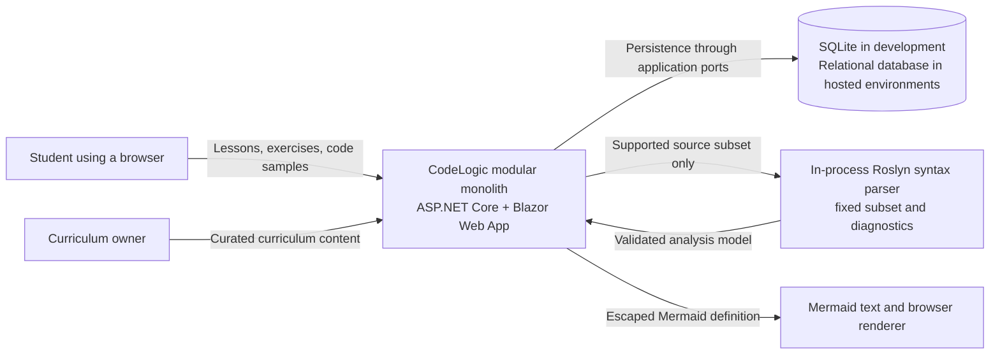
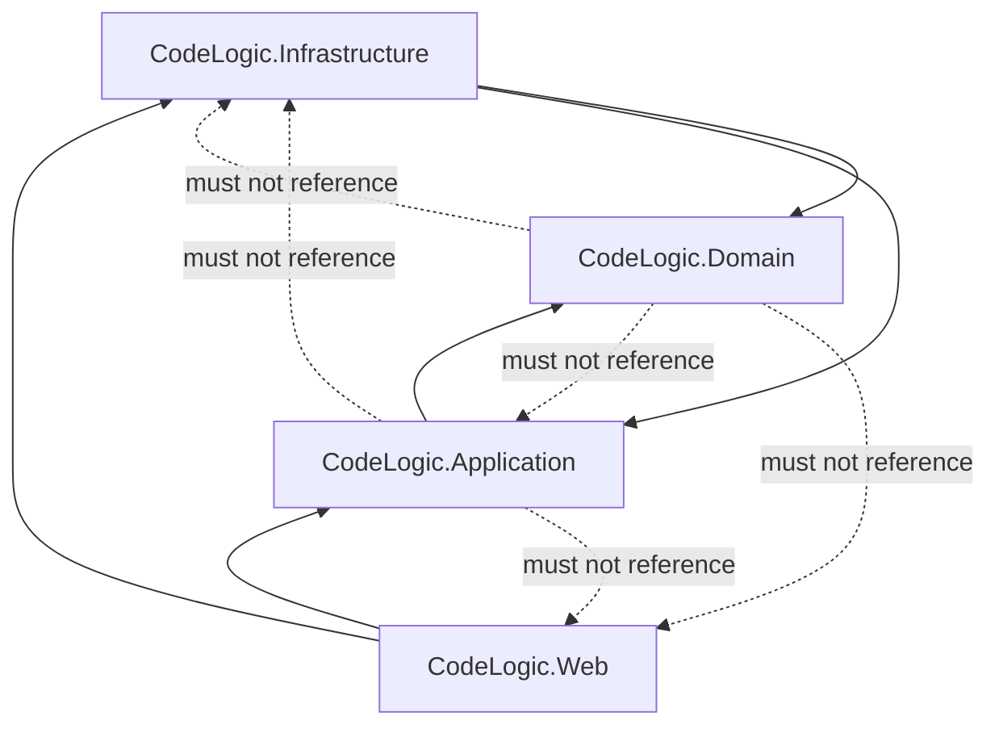
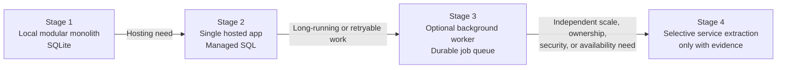

# CodeLogic Architecture

## Document Status

- Status: Implemented through Prompt 16
- Playbook task: 18 — Explain execution without running arbitrary code
- Last updated: 2026-11-01
- Implementation status: The modular-monolith projects, curriculum flow, SQLite persistence, ASP.NET Core Identity, account-owned progress, editor, bounded Roslyn parsing, graph IR, safe Mermaid browser preview, and bounded pedagogical traces are implemented. Hosted infrastructure remains planned.

## Architectural Goal

CodeLogic will be a beginner-friendly interactive C# learning application. It will teach fundamentals through lessons and deterministic exercises, then turn a deliberately limited subset of C# into explanatory flowcharts and bounded execution traces.

The initial system will be a **modular monolith**: one deployable ASP.NET Core application with clear internal boundaries. This keeps local development and debugging approachable while leaving deliberate seams for later growth.

## Guiding Principles

1. Make the learning experience correct, safe, and understandable before making the infrastructure sophisticated.
2. Keep domain and application rules independent from UI, database, and analysis tools.
3. Never execute untrusted student C# inside the web application process.
4. Prefer deterministic behavior that can be tested without network or AI services.
5. Add patterns and infrastructure only when a demonstrated need justifies their cost.
6. Treat module boundaries as enforceable dependencies, not merely folder names.

## System Context



Roslyn parsing and Mermaid serialization are in-process Infrastructure adapters behind Application interfaces. Mermaid SVG rendering occurs in the browser. None is an external microservice.

## Modular Monolith Structure

The initial solution is expected to use these projects:

```text
src/
|-- CodeLogic.Domain/
|-- CodeLogic.Application/
|-- CodeLogic.Infrastructure/
`-- CodeLogic.Web/
tests/
|-- CodeLogic.UnitTests/
`-- CodeLogic.IntegrationTests/
```

### Dependency Direction



The dashed arrows show forbidden dependencies. `CodeLogic.Web` is the composition root: it selects concrete infrastructure implementations and connects them to application interfaces.

### Boundary Responsibilities

| Boundary | Owns | Must not own |
| --- | --- | --- |
| Domain | Learning concepts, domain invariants, value objects, domain behavior | EF Core, Blazor components, HTTP, file access, Roslyn APIs |
| Application | Use cases, orchestration, ports/interfaces, authorization decisions, application DTOs | Database provider details, UI rendering, HTTP endpoints |
| Infrastructure | EF Core persistence, identity adapters, file/content adapters, Roslyn parsing adapter | Product rules or UI workflow |
| Web | Blazor pages/components, HTTP/API endpoints, dependency composition, request validation and presentation | Database queries embedded in components, core domain rules |

Feature folders may group related code within a boundary, but they do not reverse the dependency direction.

## Initial Logical Modules

Prompt 06 establishes the initial framework-independent concepts described in [DOMAIN_MODEL.md](DOMAIN_MODEL.md). The business capabilities remain:

- Curriculum: lessons, sections, topics, and curated examples.
- Practice: exercise specifications, answer evaluation, and feedback.
- Progress: attempts, completion state, and progress summaries.
- Code explanation: supported-code validation, graph construction, flowchart generation, and bounded trace descriptions.
- Identity: ASP.NET Core Identity registration, sign-in, sign-out, authorization, and user association.

Modules should communicate through application use cases and explicit contracts. They may share one process and one database initially, but one module must not directly mutate another module's tables or internal entities.

## Six Engineering Levels

| Level | How CodeLogic applies it | Guardrail |
| --- | --- | --- |
| L1 — Idiomatic C# | Clear naming, nullable reference types, LINQ where readable, small focused methods; Strategy/Factory/Adapter only when they remove real branching or isolate a tool. | Do not create patterns merely to demonstrate patterns. |
| L2 — SOLID and tests | Encapsulate invariants, separate UI from use cases, remove duplication after it appears, and test meaningful behavior. | KISS and YAGNI take priority over speculative extensibility. |
| L3 — DDD | Use bounded language for curriculum, practice, progress, and code explanation; keep pragmatic rich models where invariants exist. | Do not force aggregate roots or repositories onto simple read-only data. |
| L4 — Clean/Hexagonal | Domain at the center, application ports around it, infrastructure adapters at the edge, and Web as the composition root. | Boundaries must be visible in project references and tests. |
| L5 — Evolution | Begin with one deployable monolith. Add background workers, events, or service extraction only for measured operational needs. | No distributed system before a concrete scaling or isolation problem exists. |
| L6 — Delivery | Add repeatable builds, tests, Docker, GitHub Actions, and Azure deployment in later tasks. | Kubernetes and AWS remain optional studies, not initial production requirements. |

The levels are a growth path, not six layers that must all be implemented immediately.

## Persistence

Prompt 12 replaces temporary session ownership with ASP.NET Core Identity and account-owned database records. Anonymous visitors may read lessons, while quiz submission and progress require authentication. Web derives the owner from the authenticated claim rather than accepting a browser-supplied user ID.

The Application `LearningSessionProgress` workflow remains independent of ASP.NET Core. `IUserLearningProgressStore` is the narrow application port implemented by EF Core in Infrastructure.

- Prompt 11 implements EF Core 10 as the curriculum persistence adapter behind `ICurriculumCatalog`.
- SQLite stores the development curriculum because it is file-based and requires little setup.
- Domain and application code will not depend on SQLite-specific APIs.
- `CodeLogicDbContext`, configurations, seed conversion, catalog adapter, and migrations live in Infrastructure.
- Web supplies the development connection string and composes the adapter; Blazor components do not access `DbContext`.
- Integration tests use isolated SQLite databases and apply real migrations.
- Migrations are explicit development/deployment steps and do not run automatically at application startup.
- Hosted environments may later use Azure SQL or PostgreSQL after provider compatibility is tested.
- Development convenience does not justify running migrations automatically against production.

No generic repository is required by default. Application-specific ports or direct use of a narrow persistence abstraction should be introduced only when they improve testability or protect a boundary.

## Code Analysis and Visualization

The analysis pipeline, with Prompt 14's implemented slice shown first, is:

```mermaid
flowchart LR
    Input[Student source text]
    Gate[Size and input validation<br/>implemented]
    Parse[Roslyn syntax parsing and diagnostics<br/>implemented]
    Subset[Syntax-tree subset and nesting check<br/>implemented]
    Analyze[Bounded sequence and if/else translation<br/>implemented slice]
    IR[Custom graph intermediate representation<br/>schema 1.0 implemented]
    Render[Safe Mermaid serializer<br/>implemented]
    Browser[Strict Mermaid SVG plus text map<br/>implemented]

    Input --> Gate --> Parse --> Subset --> Analyze --> IR --> Render --> Browser
    Gate -->|Rejected with teaching feedback| Input
```



The custom graph intermediate representation (IR) prevents the UI from depending directly on Roslyn syntax trees and prevents the analysis layer from depending on Mermaid syntax. This produces two useful seams: another parser can emit the same IR, and another renderer can consume it.

Mermaid is the first renderer because text output is easy to inspect, snapshot-test, and embed. It must be treated as presentation output: labels are escaped and untrusted input cannot inject Mermaid directives or HTML.

Roslyn parsing is not code execution. Arbitrary compilation and execution remain out of scope unless a later security-approved design introduces an isolated runner with explicit resource limits.

Prompt 14 keeps Roslyn types inside Infrastructure. `ICodeAnalysisService` and neutral result records live in Application, and Web registers the adapter. The parser accepts at most 1,200 characters, applies a two-second cooperative cancellation limit and a three-level control-flow nesting limit, and reports input, syntax, unsupported-feature, or timeout outcomes. It uses syntax APIs only; semantic/type checking begins only in a future supplied task.

Prompt 15 adds Roslyn-free `FlowGraph`, `FlowNode`, `FlowEdge`, and `SourceSpan` contracts to Application. Infrastructure implements `IFlowchartTranslator` by visiting Roslyn syntax nodes. Schema 1.0 uses stable source-order IDs and explicit `Next`, `True`, and `False` edges. It translates simple sequence and one-level `if/else`; nested branches and other unimplemented control flow return positioned diagnostics without a partial graph. See [FLOWCHART_IR.md](FLOWCHART_IR.md).

Prompt 16 adds a Mermaid-specific serializer behind `IMermaidFlowchartSerializer`. The serializer owns diagram IDs and escapes learner labels. Web loads pinned Mermaid 12.2.0 on demand with strict security and HTML labels disabled, parses the returned SVG without `innerHTML`, removes active/link-capable content, and provides an equivalent node/connection list with source-selection controls. See [FLOWCHART_RENDERER.md](FLOWCHART_RENDERER.md).

Prompt 17 advances the renderer-neutral IR to schema 1.1 with an explicit `LoopBack` edge. The Infrastructure translator recursively maps nested `if/else`, `while`, `for`, and `do-while` syntax within the existing three-level analysis limit. `break` and `continue` remain explicit unsupported diagnostics until their jump semantics are introduced with focused tests. Conditions are not evaluated, so even infinite-looking syntax retains a structural exit. See [FLOWCHART_IR.md](FLOWCHART_IR.md).

Prompt 18 adds `IPedagogicalInterpreter` in Application and a Roslyn-syntax implementation in Infrastructure. It reuses validated graph boundaries, simulates only documented scalar expressions and control flow, and produces immutable snapshots containing a program counter, active graph node, variable state, and cumulative output. A 100-operation limit stops infinite-looking input. This is an interpreter for CodeLogic's teaching model—not compilation or general .NET execution. See [EXECUTION_TRACES.md](EXECUTION_TRACES.md).

## Web and API Boundaries

- Blazor components call application use cases; they do not query EF Core directly.
- HTTP endpoints, if required, expose task-focused contracts rather than domain entities or EF Core models.
- Input validation occurs at the Web boundary; business invariants remain enforced by Domain/Application behavior.
- Internal application interfaces are not automatically public APIs.
- API versioning is deferred until a real external consumer or incompatible contract change exists.

This boundary permits a future mobile client, public API, or separate frontend without requiring those clients today.

## Deployment Growth Path



Docker and GitHub Actions can make the single application repeatable before any distributed architecture is considered. Azure is the default deployment path in the playbook. Kubernetes and AWS may be studied later as comparisons, but neither is required for the initial product.

## Why Not Yet?

### Microservices

Microservices would add network failure, distributed tracing, deployment coordination, data ownership, and eventual-consistency problems before CodeLogic has validated its module boundaries or load profile. The modular monolith provides most organizational benefits at much lower learning and operational cost.

Possible future trigger: one capability requires independent scaling, stronger security isolation, a different availability target, or a separately owned release cycle. Extraction should follow an existing module seam rather than split technical layers across services.

### Broad CQRS

Separate command and query models, buses, and handlers everywhere would add indirection to straightforward learning workflows. Ordinary application services and purpose-built queries are sufficient initially.

Selective CQRS may be introduced when a specific read model is materially different from the write model, or when an asynchronous workflow requires explicit commands and events. It should remain local to that need.

### Kubernetes

Kubernetes solves orchestration problems for multiple containers at operational scale. A single web application does not justify cluster administration, manifests, ingress, secrets management, and observability overhead. Start with the simplest supported Azure hosting option and gather evidence first.

Possible future trigger: multiple independently deployed services, demanding scaling/availability requirements, and a team capable of operating a cluster. Even then, managed container platforms should be compared before Kubernetes is selected.

## Future Extraction Seams

| Seam | Current form | Potential evolution | Evidence required before evolution |
| --- | --- | --- | --- |
| Persistence | EF Core SQLite adapters behind curriculum and account-progress application ports | Azure SQL/PostgreSQL provider | Hosted environment, provider compatibility, backup, or scale requirement |
| Code analysis | In-process adapter producing graph IR | Isolated worker or service | CPU/memory contention, security isolation, or independent scaling need |
| Visualization | Mermaid renderer consuming graph IR | Alternate renderer/export service | Accessibility, export, or rendering requirement Mermaid cannot meet |
| Curriculum content | Module-owned storage accessed via application contracts | Content service or external authoring system | Independent publishing workflow or ownership need |
| Progress | Module within shared deployment | Separate reporting/read model | Proven query load or analytics requirement |
| Public access | Blazor/application calls | Versioned external API | Real external consumer and stable contract |

An extraction seam is permission to evolve, not a commitment to distribute the system.

## Architecture Quality Gates

- Domain project has no framework, EF Core, Web, or Roslyn dependency.
- Application project does not reference Infrastructure or Web.
- Blazor components do not access a database context directly.
- Student code is parsed and analyzed only within an explicitly supported subset; it is not executed in the web process.
- Graph IR tests are independent of Mermaid rendering tests.
- Provider-specific persistence behavior has integration tests.
- Architecture changes update this document and the relevant ADR before implementation is treated as complete.

## Decision Records

- [ADR 0001: Modular monolith and clean boundaries](adr/0001-modular-monolith-and-boundaries.md)
- [ADR 0002: Blazor Web App on ASP.NET Core](adr/0002-blazor-web-app-and-aspnet-core.md)
- [ADR 0003: EF Core with SQLite for local development](adr/0003-ef-core-and-sqlite-for-development.md)
- [ADR 0004: Roslyn analysis with graph IR and Mermaid first](adr/0004-roslyn-analysis-and-mermaid-visualization.md)
- [ADR 0005: Explicit API boundaries and evidence-led deployment growth](adr/0005-api-boundaries-and-deployment-growth.md)

## Known Documentation Gaps

- The hosted relational provider is not selected.
- Identity email confirmation, recovery, two-factor authentication, and account lifecycle remain deferred.
- Broader language semantics and delivery infrastructure await their numbered tasks.
