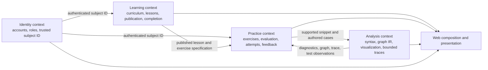

# CodeLogic Bounded Context Review

## Document Status

- Task: Prompt 22 — Architectural boundaries and DDD review
- Last updated: 2026-11-01
- Architecture: Logical bounded contexts inside one modular monolith

## Review Conclusion

CodeLogic has four useful business-language boundaries: **Learning**, **Practice**, **Analysis**, and **Identity**. They are logical modules, not four deployments and not four repeated sets of projects. The existing Domain/Application/Infrastructure/Web projects remain the physical dependency boundaries.

This review does not recommend a blanket namespace move. Current namespaces mostly align with the contexts, and renaming working code would add risk without changing dependency direction. The context map below guides new work and identifies the small integration seams that deserve attention.

## Context Map

Arrows describe contract use, not network calls. All four contexts currently share one process and, where persistence is needed, one `CodeLogicDbContext`.

## Ownership Map

### Learning

Learning owns the curriculum learners move through:

- `Topic`, `Lesson`, and `LessonSection` concepts and identifiers;
- curriculum ordering, safe curriculum manifest, navigation, and publication visibility;
- administrator-owned authored lesson draft/publish lifecycle;
- lesson completion and the learner-facing progress summary.

Learning does not decide whether a quiz answer is correct and does not parse C#.

### Practice

Practice owns deterministic learning checks:

- `Exercise`, `ExerciseKind`, `QuizCriteria`, and normalization rules;
- deterministic correct/incorrect/answer-required evaluation;
- `ExerciseAttempt`, attempt numbering, and attempt outcomes;
- known-exercise logical cases, expected/actual comparisons, and teaching hints.

Practice consumes published lesson/exercise specifications from Learning and bounded observations from Analysis. It does not compile or execute learner C#.

### Analysis

Analysis owns the explicitly supported code-explanation model:

- input limits, syntax diagnostics, supported-subset validation, and cancellation/time limits;
- renderer-neutral `FlowGraph`, nodes, edges, and source spans;
- Mermaid serialization as an adapter concern;
- bounded pedagogical trace contracts and interpreter behavior.

Application contracts remain free of Roslyn types. Roslyn and Mermaid-specific details stay in Infrastructure/Web adapters. Analysis does not own lesson progression, account authorization, or general .NET execution.

### Identity

Identity owns authentication and authorization facts:

- ASP.NET Core Identity user records, password handling, cookies, roles, and lockout;
- the Administrator role used by lesson authoring;
- production of a trusted `NameIdentifier` subject ID at the Web boundary.

Identity is currently a supporting context. `CodeLogicUser` intentionally adds no custom domain behavior to `IdentityUser`; password and account rules remain with the established framework. Learning and Practice receive only the subject ID they need and do not depend on Identity framework types.

## Current Shared Kernel and Translation Seams

`CurriculumLesson` is a small Application-owned integration record that combines a Learning lesson with a Practice exercise and quiz criteria. `LearningSessionProgress` also coordinates a curriculum lesson and quiz result when creating an attempt. This is a deliberate shared kernel for the current small team and single process.

Do not split it merely to claim stronger DDD. Revisit it if Learning and Practice gain independent owners, release cadence, storage, or APIs. At that point, a stable lesson/practice specification DTO or event would be a better translation seam than sharing internal models.

Identity integration already behaves like an anti-corruption boundary: Web reads framework claims, passes a plain string subject ID into Application ports, and Infrastructure applies ownership filters. Analysis uses a similar boundary by translating Roslyn syntax into Application-owned diagnostics, graphs, and traces.

## Rich Models Versus Simple Data

| Model kind | Current examples | Decision and reason |
| --- | --- | --- |
| Invariant-bearing domain model | `Topic`, `Lesson`, `LessonSection`, `Exercise`, `ExerciseAttempt`, `ProgressSnapshot` | Keep constructors and computed behavior together so invalid identifiers, text, ordering, counts, enums, and timestamps cannot enter normal use. |
| Stateful behavioral application model | `LearningSessionProgress` | Keep behavior-rich because it enforces attempt numbering and correct-answer completion, but leave it in Application while it coordinates Learning and Practice contracts. |
| Stateless domain service | `DeterministicQuizEvaluator` | Keep as a focused pure service because correctness depends on quiz specification plus a submitted value, not one entity's state. |
| Policy/manifest validation | `CurriculumManifestValidator`, `LessonAuthoringValidator` | Keep explicit and testable at the Application boundary; these validate cross-record or workflow rules. |
| Immutable message/data model | diagnostics, analysis results, `FlowNode`, `FlowEdge`, `SourceSpan`, trace snapshots, authored lesson views | Keep simple records/classes. They carry results across boundaries and have no independent lifecycle requiring entity behavior. |
| Persistence model | EF entities and Identity user | Keep simple and Infrastructure-only. Database mapping shape is not the domain model. |
| Web input/view state | `QuizSubmission`, Razor editor state | Keep at the Web boundary; do not promote transport fields into Domain entities. |

“Rich” does not mean every class needs methods. Behavior belongs with a model only when it protects a real invariant or answers a domain question.

## Services, Ports, and Adapters

| Application port or service | Context | Current adapter or caller |
| --- | --- | --- |
| `ICurriculumCatalog` | Learning | `EfCurriculumCatalog` |
| `ILessonAuthoringService` | Learning | `EfLessonAuthoringService` |
| `IUserLearningProgressStore` | Learning/Practice seam | `EfUserLearningProgressStore` |
| `DeterministicQuizEvaluator` | Practice | Pure Application service called by Web |
| `ILogicalFeedbackService` | Practice consuming Analysis | `InterpreterLogicalFeedbackService` |
| `ICodeAnalysisService` | Analysis | `RoslynCodeAnalysisService` |
| `IFlowchartTranslator` | Analysis | `RoslynFlowchartTranslator` |
| `IMermaidFlowchartSerializer` | Analysis | `MermaidFlowchartSerializer` |
| `IPedagogicalInterpreter` | Analysis | `RoslynPedagogicalInterpreter` |

These purpose-specific ports protect useful seams. A generic repository would erase intent such as “get published lessons” or “record an owned attempt,” so none is introduced.

## DTO Review

Application-facing contracts use Domain types, Application records, primitives, `Task`, and `CancellationToken`. They do not expose EF entities, `DbContext`, Roslyn syntax nodes, ASP.NET claims, HTTP results, or Blazor types. Architecture tests enforce that Application does not reference outer assemblies and that its port signatures remain framework-neutral.

Domain entities are not HTTP/API contracts. If a public API is later introduced, Web should map purpose-specific request/response DTOs rather than serialize Domain or EF objects directly.

## CQRS Review

Broad CQRS is not justified. Commands and queries are synchronous, use the same transactional store, and have small models. Adding mediator handlers, buses, separate databases, or duplicate models would increase navigation cost without solving an observed problem.

There are already useful CQRS-style distinctions without a framework:

- authored lesson reads distinguish owner views from public published-only views;
- authoring mutations use explicit create, update, and publish operations with version checks;
- curriculum is exposed through a read-focused catalog;
- progress has purpose-specific load and record operations.

Split an interface or add a read model only when its consumers, data shape, performance, authorization, or consistency requirements materially diverge. Record that evidence in a new ADR first.

## Dependency and Boundary Gates

Automated tests now protect:

- exact production project references: Domain has none; Application references Domain; Infrastructure references Application and Domain; Web references Application and Infrastructure;
- Domain's absence of Web, Infrastructure, Application, EF Core, ASP.NET Core, and Roslyn dependencies;
- Application's absence of Infrastructure, Web, EF Core, ASP.NET Core, and Roslyn dependencies;
- framework-neutral signatures on every current Application port.

The checks protect dependency direction, not naming aesthetics. Context ownership still requires code review because a compiler cannot determine whether a business rule was placed in the correct language boundary.

## Future Review Triggers

Revisit this map when one of these becomes real:

- independent context ownership or release cadence;
- a public/mobile client needs stable external contracts;
- Analysis requires process isolation or independent scaling;
- Practice or progress reporting requires a materially different read model;
- cross-context updates require durable asynchronous coordination;
- Identity gains profile, organization, consent, or entitlement rules beyond framework configuration.

Until then, one modular monolith with explicit ports is the lowest-cost architecture that preserves these seams.
