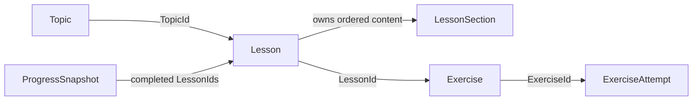

# CodeLogic Core Domain Model

## Document Status

- Status: Reviewed through Prompt 22
- Last updated: 2026-11-01
- Scope: Framework-independent Learning and Practice concepts plus pragmatic modeling guidance

This model gives the application a small, framework-independent vocabulary. It encodes rules that are true regardless of UI, database, or hosting choices. Curriculum specifications and evaluation live in Application, while durable persistence and Identity adapters live in Infrastructure.

Prompt 07 now layers a validated typed curriculum manifest over these concepts. See [CURRICULUM.md](CURRICULUM.md) for the seed contract, pilot content, safe subset, and validation rules.

## Relationships

The arrows show domain identifier relationships, not database foreign keys. Current EF Core mappings remain an Infrastructure concern and do not redefine these domain relationships.

## Concepts and Invariants

### Typed identifiers

`TopicId`, `LessonId`, `LessonSectionId`, `ExerciseId`, and `ExerciseAttemptId` wrap non-empty GUID values. Separate types prevent accidentally passing an exercise identifier where a lesson identifier is expected.

The default value of a struct can still exist in .NET, so every entity constructor also rejects a default identifier at its boundary.

### Topic

A topic groups related lessons.

Invariants:

- identifier is non-empty;
- title and description contain non-whitespace text within documented length limits;
- slug uses lowercase ASCII letters, digits, and single internal hyphens only;
- surrounding whitespace is removed from human-readable text.

### LessonSection

A section is an ordered piece of lesson content.

Invariants:

- identifier is non-empty;
- heading and content are required and length-bounded;
- order is greater than zero.

### Lesson

A lesson belongs to one topic and owns its content sections.

Invariants:

- lesson and topic identifiers are non-empty;
- title and objective are required and length-bounded;
- at least one section exists;
- section identifiers and order values are unique;
- sections are copied and exposed in ascending order, preventing callers from mutating the lesson through the original collection.

An exercise is not embedded inside `Lesson`. It references `LessonId`, which keeps the first model small and avoids turning Lesson into a speculative large aggregate.

### Exercise

An exercise is a prompt associated with one lesson.

Invariants:

- exercise and lesson identifiers are non-empty;
- title and prompt are required and length-bounded;
- order is greater than zero;
- kind is one of `MultipleChoice` or `ValueInput`.

Correct-answer specifications and evaluator behavior live in Application rather than the Domain exercise entity.

### ExerciseAttempt

An attempt records the result of an already evaluated answer.

Invariants:

- attempt and exercise identifiers are non-empty;
- attempt number is greater than zero;
- outcome is `Correct` or `Incorrect`;
- timestamp uses UTC.

The model does not store a raw answer or perform evaluation. Prompt 10 records only the evaluated outcome, attempt number, exercise identifier, and UTC timestamp.

### ProgressSnapshot

A progress snapshot is an immutable summary suitable for the later in-session vertical slice.

Invariants:

- total, attempt, and correct-attempt counts are non-negative;
- completed lesson identifiers are non-empty and unique;
- completed lessons cannot exceed total lessons;
- correct attempts cannot exceed total attempts;
- capture timestamp uses UTC;
- completion percentage is derived and rounded to two decimal places.

The snapshot has no learner or account identifier because ownership is an application/persistence concern. Prompt 12 builds it after loading only the authenticated learner's durable records.

### LearningSessionProgress application workflow

`LearningSessionProgress` joins the existing Domain models without moving HTTP or storage concerns into Domain. It:

- numbers attempts independently for each exercise;
- creates an `ExerciseAttempt` only for correct or incorrect evaluations;
- completes a lesson after a correct attempt;
- keeps completed lesson IDs unique when a learner answers correctly more than once;
- produces a `ProgressSnapshot` for the dashboard.

The Infrastructure adapter stores only attempt metadata and completed lesson IDs for an Identity user. Raw submitted answers are not stored.

## Dependency Boundary

`CodeLogic.Domain` uses the .NET base class library only. It has:

- no NuGet package references;
- no project references;
- no EF Core or persistence attributes;
- no ASP.NET Core, Blazor, HTTP, or Identity types;
- no Roslyn dependency;
- no repository interfaces.

Unit tests enforce forbidden assembly references so later changes cannot silently pull framework concerns into Domain.

## Prompt 22 DDD Review

The Domain project contains the invariant-bearing shared vocabulary for the Learning and Practice contexts; it is not intended to contain every application record. See [BOUNDED_CONTEXTS.md](BOUNDED_CONTEXTS.md) for the full context map.

The current split is deliberate:

- `Topic`, `Lesson`, `LessonSection`, `Exercise`, `ExerciseAttempt`, and `ProgressSnapshot` remain behavior-protecting Domain models because their constructors prevent invalid state and snapshots derive meaningful values.
- `LearningSessionProgress` remains a behavior-rich Application model because it coordinates Learning curriculum data with Practice evaluation results.
- `DeterministicQuizEvaluator` remains a stateless Application domain service because answer correctness depends on a quiz specification and submission rather than one entity's internal state.
- diagnostics, flow graph records, trace snapshots, authored lesson views, and other boundary results remain simple immutable data models because they carry results and do not own a lifecycle.
- EF Core entities and `CodeLogicUser` remain simple Infrastructure persistence/framework models; adding domain behavior to database rows would couple rules to adapters.

No aggregate-root base class, domain-event bus, generic repository, or project-per-context split is justified by current rules. Add one only when a concrete invariant, transaction boundary, or integration workflow requires it.

## Test Coverage

The initial tests cover:

- required text normalization;
- valid and invalid topic slugs;
- section ordering and collection copying;
- empty and duplicate section rejection;
- exercise relationship and kind validation;
- attempt number, outcome, and UTC timestamp rules;
- progress percentage and inconsistent count rejection;
- incorrect-to-correct completion flow, per-exercise attempt numbering, duplicate-completion prevention, and answer-required rejection;
- empty typed identifier rejection;
- forbidden framework and outer-layer references.

## Explicitly Deferred

- domain events and asynchronous cross-context coordination;
- aggregate-root abstractions beyond the existing invariant boundaries;
- generic repositories or command/handler frameworks;
- physical project or service separation per bounded context;
- a separate progress/reporting read model.

These items require observed complexity or operational evidence and a new ADR; the DDD label alone is not sufficient.
