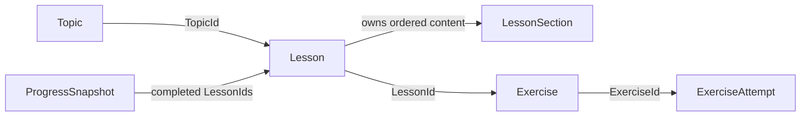

# CodeLogic Core Domain Model

## Document Status

- Status: Implemented for Prompt 06
- Last updated: 2026-10-31
- Scope: Initial curriculum, practice, attempt, and progress concepts only

This model gives later tasks a small, framework-independent vocabulary. It encodes rules that are true regardless of UI, database, or hosting choices. It does not define persistence, curriculum seed data, quiz evaluation, or application workflows.

## Relationships

The arrows show identifier relationships, not database foreign keys. Persistence mapping belongs to Infrastructure in a later task.

## Concepts and Invariants

### Typed identifiers

`TopicId`, `LessonId`, `LessonSectionId`, `ExerciseId`, and `ExerciseAttemptId` wrap non-empty GUID values. Separate types prevent accidentally passing an exercise identifier where a lesson identifier is expected.

The default value of a struct can still exist in .NET, so every entity constructor also rejects a default identifier at its boundary.

### Topic

A topic groups related lessons.

Invariants:

- identifier is non-empty;
- title and description contain non-whitespace text within documented length limits;
- slug uses lowercase ASCII letters, digits, and single internal hyphens only;
- surrounding whitespace is removed from human-readable text.

### LessonSection

A section is an ordered piece of lesson content.

Invariants:

- identifier is non-empty;
- heading and content are required and length-bounded;
- order is greater than zero.

### Lesson

A lesson belongs to one topic and owns its content sections.

Invariants:

- lesson and topic identifiers are non-empty;
- title and objective are required and length-bounded;
- at least one section exists;
- section identifiers and order values are unique;
- sections are copied and exposed in ascending order, preventing callers from mutating the lesson through the original collection.

An exercise is not embedded inside `Lesson`. It references `LessonId`, which keeps the first model small and avoids turning Lesson into a speculative large aggregate.

### Exercise

An exercise is a prompt associated with one lesson.

Invariants:

- exercise and lesson identifiers are non-empty;
- title and prompt are required and length-bounded;
- order is greater than zero;
- kind is one of `MultipleChoice` or `ValueInput`.

Correct-answer specifications and evaluator behavior are deliberately deferred to Prompt 09.

### ExerciseAttempt

An attempt records the result of an already evaluated answer.

Invariants:

- attempt and exercise identifiers are non-empty;
- attempt number is greater than zero;
- outcome is `Correct` or `Incorrect`;
- timestamp uses UTC.

The model does not store a raw answer or perform evaluation. Those decisions require the later deterministic evaluator and privacy review.

### ProgressSnapshot

A progress snapshot is an immutable summary suitable for the later in-session vertical slice.

Invariants:

- total, attempt, and correct-attempt counts are non-negative;
- completed lesson identifiers are non-empty and unique;
- completed lessons cannot exceed total lessons;
- correct attempts cannot exceed total attempts;
- capture timestamp uses UTC;
- completion percentage is derived and rounded to two decimal places.

The snapshot has no learner or account identifier because identity and persistence are not part of Prompt 06.

## Dependency Boundary

`CodeLogic.Domain` uses the .NET base class library only. It has:

- no NuGet package references;
- no project references;
- no EF Core or persistence attributes;
- no ASP.NET Core, Blazor, HTTP, or Identity types;
- no Roslyn dependency;
- no repository interfaces.

Unit tests enforce forbidden assembly references so later changes cannot silently pull framework concerns into Domain.

## Test Coverage

The initial tests cover:

- required text normalization;
- valid and invalid topic slugs;
- section ordering and collection copying;
- empty and duplicate section rejection;
- exercise relationship and kind validation;
- attempt number, outcome, and UTC timestamp rules;
- progress percentage and inconsistent count rejection;
- empty typed identifier rejection;
- forbidden framework and outer-layer references.

## Explicitly Deferred

- curriculum manifests and pilot lesson content;
- draft/published lesson lifecycle;
- answer choices and correct-answer specifications;
- deterministic answer evaluation and feedback;
- learner/session ownership of attempts;
- commands, handlers, repositories, database mappings, and migrations;
- domain events and aggregate-root abstractions.

These items should be introduced only by their numbered tasks and only when a concrete rule requires them.
