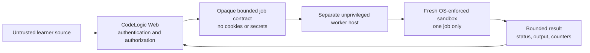

# Isolated Code Runner Experimental Spike

## Outcome

**Decision: NO-GO. The arbitrary-code runner remains disabled.**

The owner supplied Prompt 24, which approves this documentation and feasibility spike. It does not approve installing sandbox software, changing Windows features, implementing a worker, executing hostile samples, or deploying a runner.

The local machine has no verified isolation runtime. Docker and Podman are absent, WSL is not installed, and Windows Sandbox and Hyper-V tooling were not detected. CodeLogic therefore continues to use its bounded pedagogical interpreter. No learner C# is compiled, emitted, loaded, or executed as .NET.

## Evidence Collected

Evidence was collected on 2026-11-01 with read-only PowerShell commands.

| Check | Command | Observed result | Gate |
| --- | --- | --- | --- |
| Docker CLI | `Get-Command docker -ErrorAction SilentlyContinue` | Not found | Fail |
| Docker Desktop | `Test-Path 'C:\Program Files\Docker\Docker\Docker Desktop.exe'` | `False` | Fail |
| Podman | `Get-Command podman -ErrorAction SilentlyContinue` | Not found | Fail |
| WSL capability | `wsl --status` | WSL is not installed | Fail |
| WSL distributions | `wsl --list --verbose` | WSL is not installed | Fail |
| Windows Sandbox | `Test-Path 'C:\Windows\System32\WindowsSandbox.exe'` | `False` | Fail |
| Hyper-V tooling | `Get-Module -ListAvailable Hyper-V` | Module not found | Fail |
| Current execution posture | Existing security source gates and architecture | No execution endpoint, worker, compiler/emitter, process launch, or assembly-loading path | Pass |

The presence of the .NET SDK is not sandbox evidence. Microsoft documents that `AssemblyLoadContext` provides no security boundary and that unknown code needs operating-system measures such as virtualization, AppContainers, OS identities, or Hyper-V containers.

No software was installed, no Windows feature was enabled, no image was downloaded, no container was started, and no learner code was executed during the spike.

## Candidate Boundary for a Future Approved Spike

This is a design target, not an implemented architecture.

The web application must never compile or run learner code. An orchestrator may submit only a bounded job containing an opaque job ID, approved language/profile version, source within a strict size limit, and conservative quota values. The worker must receive no authentication cookie, role claims, account data, database connection, cloud identity, package-feed credentials, or application secrets.

## Mandatory Containment Contract

Every item below is required. A missing, unsupported, or unverified control keeps the feature disabled.

### Runtime and privilege

- Run on a separate, dedicated worker host or stronger micro-VM boundary, not in the CodeLogic web process or web host.
- Use an unprivileged, non-administrator identity unique to the disposable job boundary.
- Prefer a verified rootless runtime; drop all capabilities and add back none unless a security review proves one necessary.
- Prevent privilege gain, retain an enforced syscall policy, and never use privileged containers.
- Pin the worker and runtime image by immutable digest; scan and patch it through a defined lifecycle.

### Network and secrets

- Provide no external, local-network, DNS, metadata-service, or package-feed access.
- Do not attach the sandbox to a shared application network.
- Do not mount the Docker/Podman socket, host paths, user profiles, source repository, secrets, certificates, or cloud credentials.
- Do not perform learner-controlled NuGet restore or download dependencies.

### Filesystem and lifecycle

- Use a read-only runtime filesystem with a new, size-bounded temporary writable layer for each job.
- Deny device access and writes outside the job directory.
- Destroy the full writable layer on success, rejection, cancellation, timeout, crash, or host restart.
- Never reuse a job sandbox unless independent cleanup evidence proves there is no cross-job state.

### Quotas and termination

- Enforce hard memory and swap limits, CPU quota, PID/process-tree limit, wall-clock timeout, output limit, input limit, and temporary-file quota outside learner control.
- Keep limits conservative and benchmark them before approval; container defaults are not limits.
- Terminate the entire process tree when a job expires or is cancelled, then verify it is gone.
- Quarantine a worker after cleanup failure and reject new work until an operator reviews it.

### Logs and results

- Return only the opaque job ID, a fixed exit category, bounded UTF-8 output, truncation flag, and coarse timing/resource counters.
- Never return environment variables, host paths, filesystem listings, crash dumps, runtime internals, or arbitrary files.
- Log lifecycle and control outcomes without learner source, output, identity data, tokens, or secrets.
- Partition queue messages, results, logs, metrics, and temporary paths by non-guessable job capability.

## Kill Switch

Execution must be disabled by default and require all independently checked readiness conditions. The operational kill switch must support all of these actions without deploying the web application:

1. stop accepting new jobs at the orchestrator;
2. pause or drain the queue;
3. terminate active sandbox process trees;
4. revoke worker credentials and job capabilities;
5. disable the approved image digest;
6. quarantine workers with incomplete cleanup;
7. leave deterministic lessons, quizzes, flowcharts, and the pedagogical interpreter available.

Loss of the queue, worker, policy, quota controller, cleanup verifier, audit sink, or kill-switch state must fail closed. It must never fall back to in-process execution.

## Manual Security Review Checklist

This checklist is for a future owner-approved environment. Record command output, runtime versions, configuration, and test artifacts for each item. Do not test against a development machine containing secrets or personal data.

- [ ] The worker is physically or virtually separated from the web/database host.
- [ ] Runtime version, host version, isolation mode, rootless/unprivileged identity, image digest, and security policy are recorded.
- [ ] Outbound HTTP, HTTPS, DNS, local-network, host-gateway, and cloud metadata attempts all fail.
- [ ] Host files, repository files, user profiles, runtime sockets, devices, and secret stores cannot be read or written.
- [ ] Writes outside the disposable job directory fail; its byte/file quotas are enforced.
- [ ] CPU saturation is throttled and the external wall timeout kills the entire process tree.
- [ ] Memory and swap exhaustion terminates only the job while the worker and control plane remain healthy.
- [ ] Process/fork exhaustion reaches the PID limit without affecting other jobs or the host.
- [ ] Infinite output is truncated and reported without exhausting host disk or memory.
- [ ] Cancellation, crash, timeout, worker restart, and orchestrator restart all remove the job boundary and revoke its capability.
- [ ] A second account cannot submit, cancel, observe, or retrieve another account's job or result.
- [ ] Queue replay, duplicate delivery, guessed job IDs, expired capabilities, and malformed results fail closed.
- [ ] Logs and metrics contain no learner source/output, account identifiers, environment values, tokens, or secrets.
- [ ] Removing any required sandbox control prevents startup or job acceptance.
- [ ] The kill switch stops new work and terminates active work without disabling the normal learning application.
- [ ] An independent security reviewer accepts the evidence and residual-risk statement.

## Go/No-Go Rule

The runner may proceed to a separate implementation proposal only when every checklist item has repeatable evidence on the exact proposed host/runtime combination, an independent security review is complete, the owner explicitly approves the residual risk, and a new ADR defines deployment and rollback. Passing a few container tests is insufficient.

The current result is **NO-GO** because no supported sandbox runtime is installed or verified. Prompt 24 adds no runner and changes no production behavior.

## Authoritative References

- [Microsoft secure coding guidelines for unknown code](https://learn.microsoft.com/en-us/dotnet/standard/security/secure-coding-guidelines)
- [Microsoft `AssemblyLoadContext` security remarks](https://learn.microsoft.com/en-us/dotnet/api/system.runtime.loader.assemblyloadcontext)
- [Docker resource constraints](https://docs.docker.com/engine/containers/resource_constraints/)
- [Docker rootless mode](https://docs.docker.com/engine/security/rootless/)
- [Docker container run security and limit options](https://docs.docker.com/reference/cli/docker/container/run/)
- [Docker seccomp profiles](https://docs.docker.com/engine/security/seccomp/)
- [Docker none network driver](https://docs.docker.com/engine/network/drivers/none/)

