# CodeLogic Product Charter

## Document Status

- Status: Proposed for owner review
- Playbook task: 01 — Product charter and scope
- Last updated: 2026-10-31
- Implementation status: Product definition only; no application features exist yet

## Product Summary

CodeLogic is a beginner-friendly web application for learning foundational C# programming. It combines short lessons, deterministic exercises, a simple code editor, and explanatory flowcharts so a learner can connect source code with the order in which a program makes decisions and repeats work.

The MVP is a guided learning tool, not a general-purpose development environment. It supports a deliberately limited and documented subset of C# that can be analyzed safely and explained consistently. It must remain useful without generative AI, paid APIs, or an internet connection after local setup.

## Product Promise

A beginner can read a focused C# lesson, practice the concept, enter or adjust a supported example, and receive a predictable visual explanation without executing arbitrary code or depending on AI-generated answers.

## Target Users

### Primary: First-time C# learner

A student who understands how to use a computer but has little or no programming experience. They need plain language, small steps, immediate feedback, and a clear connection between code and program flow.

Typical needs:

- learn syntax without being overwhelmed by professional tooling;
- understand why a result is correct or incorrect;
- see how sequence, conditions, and loops change execution flow;
- recover from mistakes without losing progress or context;
- use the application with keyboard, screen magnification, or assistive technology.

### Secondary: Self-taught learner revisiting fundamentals

A learner who has seen basic C# but has gaps in mental models. They need concise explanations, targeted practice, and a way to visualize control flow.

### Secondary: Instructor or mentor

A teacher, tutor, or senior learner who wants a consistent demonstration tool and a predictable set of exercises. Curriculum authoring and classroom administration are not part of the first MVP; instructors use the same learner-facing content.

## Problems to Solve

1. **Syntax appears disconnected from behavior.** Beginners can copy code without understanding which statement runs next or why a branch was selected.
2. **Compiler and IDE feedback can be overwhelming.** Professional tools expose many concepts before a beginner has the vocabulary to interpret them.
3. **Passive reading does not prove understanding.** Learners need small exercises with explanations, not only completed examples.
4. **Unbounded playgrounds are unsafe and hard to explain.** Executing arbitrary code introduces security risks and behaviors beyond a beginner curriculum.
5. **AI-dependent feedback can be inconsistent or unavailable.** Core instruction must be reproducible, reviewable, and usable without an external AI service.
6. **Inaccessible learning interactions exclude users.** Mouse-only controls, color-only meaning, poor focus order, and dense diagrams create unnecessary barriers.

## Beginner Learning Outcomes

After completing the MVP learning path, a learner should be able to:

1. Explain that C# statements normally execute in sequence.
2. Declare variables using common beginner types and describe the difference between a variable's name, type, and value.
3. Use basic arithmetic, comparison, and Boolean operators in supported expressions.
4. Predict simple console-style input/output results from curated examples without running arbitrary code.
5. Trace an `if`/`else` decision and explain why one path is taken.
6. Trace bounded `for` and `while` loops and identify initialization, condition, body, and update behavior.
7. Read and call a simple method with parameters and a return value.
8. Break a small problem into ordered steps and compare those steps with a flowchart.
9. Interpret deterministic feedback, correct a mistake, and retry an exercise.
10. Recognize when submitted code uses a construct outside CodeLogic's supported subset.

The MVP does not claim that completing these outcomes makes a learner job-ready or proficient in the full C# language.

## Learning and UX Principles

- Present one main concept at a time.
- Explain new terminology before using it as shorthand.
- Pair code with a plain-language explanation and a visual model.
- Keep examples short enough to trace manually.
- Provide corrective feedback that explains the rule, not merely “wrong.”
- Let learners retry without penalty.
- Show progress honestly and avoid manipulative streaks or pressure.
- Distinguish unsupported input from incorrect input.
- Never represent generated or inferred output as actual code execution.

## Core UX Journey

```mermaid
flowchart LR
    Start[Open CodeLogic]
    Browse[Choose a lesson]
    Learn[Read objective and explanation]
    Example[Study a short code example]
    Practice[Answer a deterministic exercise]
    Feedback[Review rule-based feedback]
    Editor[Edit a supported code sample]
    Visual[Inspect flowchart and bounded trace]
    Reflect[Review lesson progress and next step]

    Start --> Browse --> Learn --> Example --> Practice --> Feedback
    Feedback -->|Retry| Practice
    Feedback -->|Continue| Editor --> Visual --> Reflect
    Visual -->|Revise supported code| Editor
```

### Journey details

1. **Orient:** The home page explains what CodeLogic teaches and offers a clear “Start learning” action.
2. **Choose:** The lessons page shows ordered topics, brief objectives, and honest completion state.
3. **Learn:** A lesson presents an objective, explanation, accessible code example, and one primary next action.
4. **Practice:** A learner answers multiple-choice or value-based questions evaluated by explicit rules.
5. **Understand feedback:** Correct and incorrect answers receive deterministic explanations.
6. **Explore:** A simple editor allows changes within the supported C# subset and clearly states its limitations.
7. **Visualize:** CodeLogic produces a stable flowchart and bounded textual trace from validated analysis; it does not execute the learner's program.
8. **Continue:** A signed-in learner sees saved progress and a recommended next lesson without being forced forward.

## Prioritized MVP

Priorities use **Must**, **Should**, and **Could**. Only Must items are required for the first releasable learning slice.

### Must: Guided lessons

- An ordered lesson list with topic, objective, and availability state.
- At least two complete pilot lessons covering foundational concepts.
- A lesson detail view with explanation, code example, learning objective, previous/next navigation, and practice action.
- Initial curriculum direction covering variables/types, operators, input/output, sequence, branching, loops, methods, algorithms, and debugging, with non-pilot material allowed to remain clearly marked as draft.

### Must: Deterministic exercises

- Multiple-choice and normalized value-based answers defined by exercise specifications.
- Explicit correct, incorrect, and retry states.
- Rule-based explanations for expected answers.
- Boundary and invalid-answer handling without dynamic C# execution.

### Must: Simple supported-code editor

- A text editor for short, curated C# examples and learner modifications.
- Clear supported-subset guidance and useful rejection messages.
- Keyboard operation for editing and submitting.
- Input size and complexity limits suitable for bounded analysis.
- No arbitrary compilation or execution.

The MVP editor is not expected to match Visual Studio features. Syntax highlighting is beneficial but not required for the first vertical slice if plain text remains readable and accessible.

### Must: Deterministic visualization

- Parse and analyze only documented supported constructs.
- Convert supported code into a renderer-neutral graph representation.
- Render an explanatory Mermaid flowchart with escaped labels.
- Provide a bounded text trace or ordered explanation alongside the diagram.
- Produce the same logical graph for the same normalized input and version.
- Explain unsupported syntax instead of guessing.

### Must: Accessible learning UX

- All core learning actions are operable by keyboard alone.
- Visible focus indicators are present and not obscured.
- Pages use semantic headings, labels, landmarks, and meaningful control names.
- Information is not communicated by color alone.
- Text and essential controls meet WCAG 2.2 AA contrast targets.
- Layout remains usable at 200% browser zoom and on a narrow mobile viewport without losing core content or actions.
- Validation and exercise feedback are announced and associated with the relevant input.
- Code and diagrams have equivalent text explanations; understanding the diagram is not required to complete the lesson.
- Motion is non-essential and respects reduced-motion preferences.

### Must: Honest progress

- In-session lesson completion and attempt state for the first vertical slice.
- A progress view that clearly states when data is temporary and not yet persisted.
- No false claim that a learner has mastered a topic based on one answer.

### Should: Persistent learner account and progress

- ASP.NET Core Identity sign-in.
- Stored lesson completion and exercise attempts.
- Ability to resume on another session after persistence is introduced.

These are important product capabilities but are not required to prove the first in-memory vertical slice.

### Could: Learning refinements

- Optional hints authored with each exercise.
- Additional examples for the same concept.
- Lightweight instructor demonstration mode.
- Exportable or printable lesson summaries.

Could items must not delay Must acceptance criteria.

## Supported-Code Safety Boundary

CodeLogic teaches through static, bounded analysis. The MVP must:

- accept only a documented subset of C# constructs;
- reject excessive input size, nesting, or analysis complexity;
- parse with trusted tooling when Roslyn is introduced;
- escape untrusted text before visualization;
- avoid compiling or executing learner-submitted code in the web application process;
- avoid network, file, process, reflection, unsafe, and package-loading capabilities in learner input.

A future arbitrary-code runner would require a separate security design, process or infrastructure isolation, resource limits, abuse controls, and explicit owner approval. It is not implied by the word “editor.”

## No AI Dependency

The MVP's lessons, answer evaluation, feedback, supported-code analysis, flowcharts, and traces must work without generative AI.

- Curriculum content is human-authored and reviewable.
- Exercise outcomes are calculated from explicit specifications.
- Visualizations are produced from deterministic program analysis.
- The core experience does not require an API key, paid AI service, or network call to an AI provider.
- The UI must not suggest that deterministic feedback was generated by an intelligent tutor.

Optional AI assistance may be studied later only as an enhancement. It must have a non-AI fallback, disclose its use, protect learner data, and never become required for core learning outcomes.

## Explicitly Deferred Features

The following are outside the MVP and require later prioritization:

- arbitrary C# compilation or execution;
- a production-grade IDE, debugger, terminal, package manager, or Git client;
- free-form AI tutoring, AI-generated lessons, or AI-generated grading;
- instructor curriculum authoring and publishing tools;
- classroom rosters, assignments, grading, and learning-management-system integration;
- real-time collaboration, shared editing, chat, or social feeds;
- gamification systems such as points economies, leaderboards, streak pressure, or achievements;
- full C# language coverage, multi-file projects, NuGet packages, reflection, unsafe code, or platform APIs;
- native mobile or desktop applications;
- offline-first synchronization or installable PWA behavior;
- localization beyond the initial product language;
- advanced analytics, recommendations, or mastery prediction;
- public developer API and third-party integrations;
- microservices, broad CQRS, Kubernetes, and multi-cloud deployment;
- payment, subscription, advertising, or marketplace features.

Deferred means intentionally not promised for the MVP, not silently planned work.

## Non-Goals

CodeLogic is not intended to:

- replace Visual Studio, the .NET documentation, an instructor, or a complete C# course;
- run arbitrary programs or guarantee that learner code is production-ready;
- teach every C# language feature or .NET framework;
- provide accredited assessment or certify professional competency;
- use AI as the source of truth for correctness;
- hide compiler concepts permanently—professional tools should be introduced gradually after foundational understanding;
- optimize for expert developers at the expense of beginner clarity;
- become a distributed-systems demonstration project before product needs justify that complexity.

## Measurable MVP Acceptance Criteria

### Lessons

1. At least two pilot lessons are complete and reachable from an ordered lesson list.
2. Each pilot lesson displays one explicit objective, a plain-language explanation, at least one short code example, a practice action, and previous/next navigation where applicable.
3. Missing or unknown lesson identifiers produce a helpful recovery state rather than an unhandled error.
4. A learner can reach a pilot lesson from the home page using keyboard-only navigation.

### Exercises

1. Each pilot lesson contains at least one deterministic exercise.
2. Automated tests cover correct, incorrect, empty/invalid, normalized, and boundary answers.
3. Repeating the same answer against the same exercise specification produces the same result and explanation.
4. An incorrect answer can be retried without reloading the application or losing lesson context.
5. Exercise evaluation does not compile or execute submitted C#.

### Simple editor

1. A learner can open a curated example, edit text, submit it for analysis, and revise it after feedback using only the keyboard.
2. The editor states that CodeLogic analyzes a limited subset and does not execute the code.
3. Valid supported input reaches visualization; unsupported, oversized, or excessively complex input returns a specific and actionable message.
4. An analysis failure does not lose the learner's submitted text.

### Deterministic visualization

1. Supported examples for sequence, one conditional branch, and one bounded loop each produce an expected graph verified by automated tests or approved snapshots.
2. The same normalized source and application version produce the same graph nodes and edges.
3. Every rendered diagram has an equivalent ordered text explanation.
4. User-controlled labels are escaped so they cannot inject Mermaid directives or active content.
5. Visualization occurs without executing learner code or calling a generative AI service.

### Accessible UX

1. All MVP flows—select lesson, read content, answer exercise, edit supported code, request visualization, and continue—are keyboard operable with visible focus.
2. Automated accessibility checks report no known critical violations on the home, lesson list, lesson detail, exercise, editor, visualization, and progress views.
3. Manual checks confirm logical focus order, meaningful labels, feedback announcement, 200% zoom usability, reduced-motion behavior, and non-color status cues.
4. Core content and actions remain usable at a 320 CSS-pixel viewport without two-dimensional page scrolling; code blocks may scroll horizontally within their own labeled region.

### End-to-end learning slice

1. A learner can open a pilot lesson anonymously; after signing in, they can answer its exercise, mark the lesson complete, and see durable account-owned progress.
2. The product clearly explains that lessons are public while quiz submission and saved progress require an account.
3. The end-to-end flow requires no AI service, cloud deployment, or arbitrary-code runner.

## MVP Review Checklist

Before calling the MVP complete, the owner reviews:

- [ ] Lessons teach the agreed beginner outcomes in a sensible order.
- [ ] Exercises are deterministic and explanations are human-authored.
- [ ] The editor's supported subset and non-execution boundary are unmistakable.
- [ ] Visualization matches approved graph expectations and includes text equivalents.
- [ ] Keyboard, zoom, contrast, focus, feedback, and reduced-motion checks pass.
- [ ] Core learning works without generative AI or an AI API key.
- [ ] Deferred features have not entered the MVP through incidental implementation.
- [ ] Limitations and temporary progress behavior are communicated honestly.

## Product Decisions Requiring Owner Review

- Confirm the exact two pilot lesson topics when the curriculum prompt is executed.
- Confirm whether account-based persistent progress belongs in the first public release or immediately after the in-memory vertical slice.
- Confirm the initial product language and accessibility testing tools.
- Approve the supported C# subset before editor and analysis implementation.

## Related Architecture

The technical boundaries supporting this charter are described in [ARCHITECTURE.md](ARCHITECTURE.md). If product scope changes, architecture decisions must be revisited rather than silently stretched.
