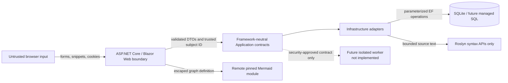

# CodeLogic Security Threat Model

## Document Status

- Task: Prompt 24 — Isolated code runner experimental spike
- Last updated: 2026-11-01
- Execution posture: Arbitrary .NET compilation and execution are disabled
- Scope: Current modular monolith plus a no-go feasibility review for a possible future isolated worker

## Security Decision

CodeLogic parses and explains a deliberately supported C# subset. It does **not** compile, emit, load, or execute learner code as .NET. There is no execution endpoint, worker project, file-upload route, compiler service, child-process launch, or assembly-loading path.

The bounded pedagogical interpreter is an authored teaching model. It evaluates only supported syntax with explicit limits and must not be described as a sandbox for general C#.

Prompt 24 found no verified local sandbox runtime: Docker and Podman are absent, WSL is not installed, and Windows Sandbox and Hyper-V tooling were not detected. The result is **NO-GO**. No worker, image, compiler, execution endpoint, or deployment was added. See [ISOLATED_RUNNER_SPIKE.md](ISOLATED_RUNNER_SPIKE.md) and [ADR 0009](adr/0009-defer-isolated-runner-until-containment-is-verified.md) for the evidence, kill switch, and manual security checklist.

## Assets

- Identity credentials, authentication cookies, roles, and account identifiers;
- account-owned attempts, completion records, and authored lessons;
- curriculum integrity and publication state;
- learner snippets held in browser state or submitted for bounded analysis;
- application availability, CPU, memory, disk, and database capacity;
- logs and diagnostics, which must not reveal passwords, answers, source, or cross-user data.

## Trust Boundaries

Browser input is untrusted even when it comes from a hidden field, `maxlength` control, local storage, authenticated account, or administrator UI. Authentication establishes account identity; it does not make content safe.

## Threats and Current Controls

| Threat | Example | Current controls | Residual risk / next trigger |
| --- | --- | --- | --- |
| Malicious snippet | `Process.Start`, file access, reflection, networking, infinite loops | 1,200-character limit, three-level nesting limit, syntax-only Roslyn validation, supported-type/API allowlist, two-second analysis timeout, 100-operation interpreter limit, no compilation/execution primitives | The interpreter is not a security sandbox; every new supported syntax feature needs negative tests. |
| File upload | Executable, archive bomb, oversized source file, path traversal | No upload control or route exists; static tests fail if an upload surface appears. Requests and multipart forms are capped at 64 KiB. | Any future upload requires a separate threat model, storage quarantine, content/type validation, quotas, malware strategy, and authorization tests. |
| Resource exhaustion | Huge form values, deep syntax, infinite-looking loop, password-hash abuse | 64 KiB request/multipart limit, 16 KiB form value limit, 32-value cap, account field limits, analysis time/size/nesting limits, trace operation limit, cancellation propagation | Per-IP/account rate limiting and distributed quotas are not implemented; required before public scale. |
| Authentication attack | Brute force, credential stuffing, account enumeration | ASP.NET Core Identity hashing, strong password policy, unique email, five-attempt lockout, generic login failure, bounded 128-character password input | Email confirmation, MFA, recovery, breached-password checks, and production rate limiting remain required for public deployment. |
| Tenant/account leakage | Supplying another user's ID or authored lesson ID | Web derives `NameIdentifier`; browser does not submit owner IDs; EF reads/writes filter by owner; foreign keys/indexes reinforce ownership; cross-user tests exist | SQLite is not database-level row security. Every new owner-scoped query requires a negative cross-user test. |
| CSRF | Cross-site quiz, registration, logout, or login POST | Antiforgery middleware and tokens on every state-changing Razor form; Identity cookie is SameSite Lax; sign-out is POST | New endpoints must keep antiforgery metadata/tokens or use a separately reviewed API authentication design. |
| Stored/reflected XSS | Lesson text or snippet injects HTML/script | Razor encodes strings; no `MarkupString` is used for authored content; Mermaid labels are escaped; SVG is parsed, sanitized, stripped of active/link content, and inserted with `replaceChildren`, never `innerHTML` | Rich HTML authoring is not supported. Adding it requires an allowlist sanitizer and stored-XSS tests. |
| Mermaid injection/supply chain | Directives, click handlers, hostile SVG, compromised CDN | Pinned Mermaid version, strict mode, HTML labels disabled, label escaping, DOM sanitizer, text equivalent, size/edge limits | The module is remote and has no SRI path for dynamic ESM import. Self-hosting and a nonce-based CSP should be evaluated before public deployment. |
| SQL/command injection | Crafted slug, answer, or email reaches SQL/shell | EF Core parameterization; no shell commands, handwritten SQL, compiler invocation, or process launch in request paths | Raw SQL or external tools require parameterization and explicit security review. |
| Open redirect | Crafted return URL after login/register | Only a single local path beginning with `/` is accepted; `//`, `/\`, blank, and oversized values fall back to `/` | External return URLs remain unsupported. |
| Clickjacking/browser capability abuse | App embedded in hostile frame or requests camera | `X-Frame-Options: DENY`, restrictive Permissions Policy, no-referrer policy, MIME sniffing disabled, cross-origin opener isolation | A full CSP is deferred until Blazor/import-map and Mermaid module requirements are nonce/self-host compatible. |
| Sensitive logging | Password, raw answer, learner source, email, owner ID in logs | Application logs record IDs/statuses needed for operations but omit those sensitive values; detailed exception output is not served in production | Operators still need retention/access policy and secret scanning in a delivery task. |

## Input and Request Limits

Server-side checks are authoritative; browser attributes are only usability aids.

| Input | Limit |
| --- | ---: |
| HTTP request or multipart body | 65,536 bytes |
| One form value | 16,384 bytes |
| Form value count | 32 |
| Email | 254 characters |
| Password submitted to Identity | 128 characters |
| Local return URL | 2,048 characters |
| Analysis/editor source | 1,200 characters |
| Analysis nesting | 3 control-flow levels |
| Analysis duration | 2 seconds |
| Pedagogical trace | 100 operations |

These limits reduce accidental and malicious work before expensive parsing, password verification, database access, or rendering. They are not a replacement for deployment-level rate limiting.

## Browser Security Headers

Every response receives:

- `Cross-Origin-Opener-Policy: same-origin`;
- a Permissions Policy disabling accelerometer, camera, geolocation, gyroscope, microphone, payment, and USB;
- `Referrer-Policy: no-referrer`;
- `X-Content-Type-Options: nosniff`;
- `X-Frame-Options: DENY`;
- `X-Permitted-Cross-Domain-Policies: none`.

Production already uses HTTPS redirection and HSTS. Cookie `SecurePolicy` follows the request so local HTTP development works; hosted environments must terminate and forward HTTPS correctly.

A Content Security Policy is not added blindly. The current Blazor import map and remote Mermaid ESM module require a reviewed nonce/self-hosting design. A CSP that is present but relaxed with broad `unsafe-inline` or broken in production would provide false confidence.

## Fail-Closed UX Contract

Security-related input has four visible outcomes:

- **Invalid input:** empty or over the declared limit; no analysis result is produced.
- **Unsupported input:** valid C# syntax outside the teaching subset; diagnostics explain the boundary and no partial trace is returned.
- **Limit reached:** analysis timeout or trace operation cap; work stops with a stable limit diagnostic.
- **Internal failure:** central error handling returns a generic recovery page and correlation ID without exception details.

The UI must never imply that rejected source was “mostly run,” silently ignore dangerous statements, or display a partial trace after an unsupported result. Unknown features fail closed.

## Negative Security Gates

Tests protect the current posture:

- process, file-write, reflection, network-client, object-creation, unsupported types, deep nesting, oversize source, cancellation, and timeout paths are rejected;
- a malicious process-launch snippet produces Unsupported and an empty trace;
- production source contains none of the named compiler, emit, assembly-load, or process-launch primitives;
- Web contains no `IFormFile`, file input, or upload endpoint;
- every state-changing Razor form has an antiforgery token and middleware precedes endpoint mapping;
- Mermaid keeps strict mode, sanitizer calls, forbidden SVG removal, `replaceChildren`, and no `innerHTML`;
- account and request limits are explicit;
- existing tests deny cross-user progress/authoring access and escape Mermaid labels.

Static source gates are defense-in-depth, not a substitute for review. If a future approved worker legitimately needs a forbidden primitive, it must live in a separately reviewed project and the gate must be changed only alongside the new security ADR.

## Future Isolated Worker Security Contract

This section is a design prerequisite, not implementation approval. No worker may execute code until a separate security task accepts an operating-system-specific sandbox design and adversarial test evidence.

### Orchestrator-to-worker request

The request may contain only:

- opaque one-time job ID and opaque owner/tenant partition ID;
- supported language/version identifier;
- UTF-8 source within an enforced byte/character cap;
- server-selected resource profile and deterministic input fixtures;
- expiration timestamp and integrity/authenticity proof.

Clients must not choose executable paths, command-line arguments, environment variables, mounts, network rules, host paths, identities, or resource limits. Limits may be lowered per job but never raised above server policy.

### Mandatory isolation

Each job requires a fresh, unprivileged OS security boundary such as a locked-down container, sandboxed process identity, or micro-VM selected through a dedicated security review. Merely starting `dotnet` as a child process is insufficient.

The boundary must enforce:

- no inbound or outbound network, DNS, loopback access, or cloud metadata access;
- no host, source-repository, home-directory, Docker-socket, database, secret, or credential mounts;
- read-only runtime image and a new empty writable workspace with a byte quota;
- non-root, per-job identity with no reusable credentials or ambient capabilities;
- fixed wall-clock timeout, CPU quota, memory limit, process/PID/thread limit, output limit, and file count/size limit;
- termination of the entire process tree on completion, timeout, cancellation, protocol error, or orchestrator disconnect;
- no cross-job shared writable cache and no worker reuse across owners unless cleanup has been independently verified.

Suggested initial upper bounds must be conservative and benchmarked before approval: seconds rather than minutes, tens or low hundreds of MiB rather than host-scale memory, one job process tree, small output, and a small ephemeral filesystem. Exact values depend on the chosen sandbox/runtime and therefore are not invented in this documentation-only contract.

### Identity and tenant isolation

- The worker never receives the Identity cookie, password, email, role claims, database connection string, or application secrets.
- The orchestrator authenticates the user, authorizes the exercise, creates an opaque job capability, and verifies the returned job/partition IDs.
- Results are stored and retrieved through owner-filtered orchestrator operations; workers never query the application database directly.
- Queues, logs, metrics, temporary paths, and object keys include non-guessable job partitions and must not expose another owner's content.

### Output contract

Return only bounded UTF-8 stdout/stderr, exit category, timing/resource counters, and the opaque job ID. Truncate output with an explicit flag. Do not return environment data, filesystem listings, crash dumps, host paths, tokens, or arbitrary worker files.

### Cleanup and evidence before enablement

On every terminal path, the orchestrator must terminate the job boundary, discard the writable layer, revoke the job capability, remove queue leases, and record a non-sensitive audit event. Cleanup failure quarantines the worker and blocks reuse.

Before any feature flag can enable execution, tests must demonstrate blocked network/DNS/metadata access, denied host files/mounts, enforced CPU/memory/PID/time/output/file quotas, process-tree termination, cancellation, cross-tenant denial, cleanup after crash/timeout, image provenance, dependency scanning, and fail-closed behavior when any sandbox control is unavailable. The Task 24 checklist requires repeatable evidence on the exact proposed runtime plus independent security review and explicit owner acceptance.

## Explicitly Out of Scope

- arbitrary .NET compilation or execution;
- “safe” in-process execution, `AssemblyLoadContext` isolation, or AppDomain-based sandboxing;
- public code/file uploads;
- network-enabled packages or NuGet restore for learner code;
- production rate-limiting infrastructure, WAF configuration, SIEM, or secret management;
- enabling a worker based only on this design document.

## Manual Visual Studio Verification

1. Run the security-focused tests and confirm all negative cases pass.
2. Start Web and inspect response headers in browser developer tools.
3. Submit `System.Diagnostics.Process.Start("calc");` in Playground; confirm Unsupported appears and no trace steps exist.
4. Try file, reflection, and network-client examples; confirm actionable unsupported diagnostics.
5. Enter oversized email/password values by bypassing browser attributes; confirm the account action returns the generic invalid result.
6. Remove an antiforgery token only in a temporary local experiment and confirm the POST is rejected; restore the file without committing that experiment.
7. Use two accounts and confirm progress and authored drafts remain owner-isolated.
8. Inspect logs and confirm they contain no password, email, raw answer, authored prose, or learner source.
